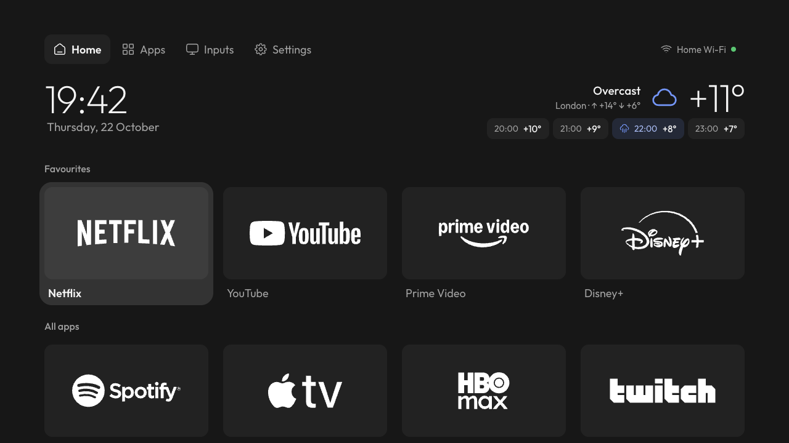
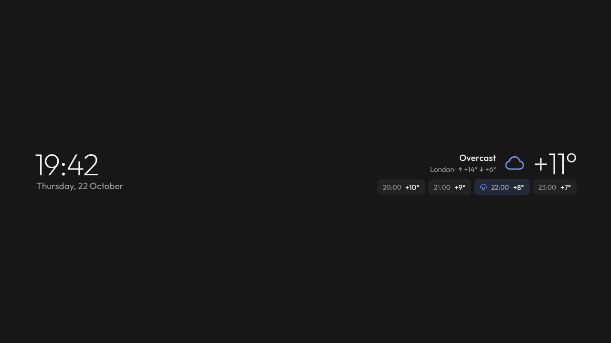

# stillOS

**English** · [Русский](README.ru.md)

A calm home screen for Android TV. No banners shouting for attention, no rows of recommendations: your apps on quiet
tiles with their white logos, the time, the weather, and nothing else. stillOS is a restyle of the launcher from
[cleanyourtv](https://github.com/Gathin23/cleanyourtv), designed in Paper and built for a cheap Xiaomi TV that used
to lag and show ads before you could reach your apps.



<sub>Design mockup with the English interface and an international set of apps. The real-device screenshots are in
the [Russian README](README.ru.md).</sub>

## What it changes

- **Neutral tiles with white logos.** Every app gets the same dark tile with the service's own logo in white, instead
  of each app's colourful banner. 28 services are included: Netflix, YouTube, Prime Video, HBO Max, Disney+,
  Apple TV, YouTube Music, Spotify, Twitch, Crunchyroll, Plex, Kodi, Jellyfin, Google Play and the main Russian
  services. Any other app shows its name.
- **A plain header.** Home, Apps, Inputs and Settings with [Untitled UI](https://www.untitledui.com/free-icons)
  icons. Inputs opens a small dropdown of HDMI, AV and live TV.
- **The weather.** Now, today's high and low, and the next four hours, with rain hours highlighted. Press OK on it to
  pick a city from a short list or search for any.
- **Network at a glance.** The Wi-Fi or Ethernet icon, the network name and a dot: green when the internet answers,
  amber when the network has none, red when offline.
- **A screensaver to match.** The clock, the date and the weather in one row. It drifts a few pixels a minute, too
  slowly to notice, so nothing burns in.
- **Calm motion.** One soft focus plate glides between tiles; nothing zooms or bounces.
- **Favourites you edit from the remote.** Hold OK on Settings and choose *Edit favourites*.
- **Remote keys.** On the MiTV remote the Netflix key opens VK Video and ▦ opens all apps. Change them in
  `launcher/app/src/main/res/values/config.xml` (`app_keys`).



<sub>Design mockup of the screensaver in English.</sub>


## Tested on

Xiaomi MiTV-MOSR1 (Android TV 11, 1280×720, 1 GB). It should run on other Android TV sets the cleanyourtv launcher
runs on (Android 8 and up), but only this one has been checked. The debloat list for this TV is in
[`examples/xiaomi-mitv-mosr1`](examples/xiaomi-mitv-mosr1/debloat.txt).

## Install

You need a computer on the same network as the TV, JDK 17 and the Android SDK (platform 34).

1. On the TV, turn on Developer options (Settings → Device preferences → About → press OK on *Build* seven times),
   then turn on USB debugging. Note the TV's IP address.
2. Clone this repository.
3. Optional: disable the preinstalled apps you don't want. Everything is disabled, not uninstalled, and comes back
   with one command.

   ```bash
   TV_HOST=192.168.1.50 tools/disable.sh examples/xiaomi-mitv-mosr1/debloat.txt
   ```

4. Build the launcher and make it Home:

   ```bash
   TV_HOST=192.168.1.50 HOME_KEY_SERVICE=1 launcher/build-and-install.sh
   ```

5. Accept the debugging prompt on the TV and press Home on the remote.

To go back to the stock launcher, run
`TV_HOST=192.168.1.50 tools/restore.sh examples/xiaomi-mitv-mosr1/debloat.txt com.google.android.tvlauncher`
(the last argument is your TV's stock launcher). See
[`CLEANYOURTV.md`](CLEANYOURTV.md) for the details, other TVs, and the AI-agent route through
[`PROMPT.md`](PROMPT.md).

## Network

The launcher talks to two services, and only for the weather:

- [MET Norway](https://api.met.no/) (the yr.no forecast): one small request every 30 minutes while Home or the
  screensaver is on screen, with the coordinates of the chosen city.
- [OpenStreetMap Nominatim](https://nominatim.openstreetmap.org/): only when you search for a city, with what you
  typed.

Both are free, need no key and get a User-Agent naming this project. Nothing else leaves the TV: no accounts, no
analytics.

## Logos and credits

The service logos are trademarks of their owners, used only to label their own apps on the tiles. No company
endorses this project; if you own a mark and want it removed, open an issue. Every logo's source is listed in
[`design/brand/NOTICE.md`](design/brand/NOTICE.md).

- Launcher and tools: [cleanyourtv](https://github.com/Gathin23/cleanyourtv) by Gathin and contributors, MIT.
- Icons: [Untitled UI](https://www.untitledui.com/free-icons) free set.
- Font: [Outfit](https://fonts.google.com/specimen/Outfit), SIL Open Font License.
- Weather data: [MET Norway](https://api.met.no/), CC BY 4.0. Place search: © OpenStreetMap contributors, ODbL.

The code is MIT, like the project it comes from: see [`LICENSE`](LICENSE).
