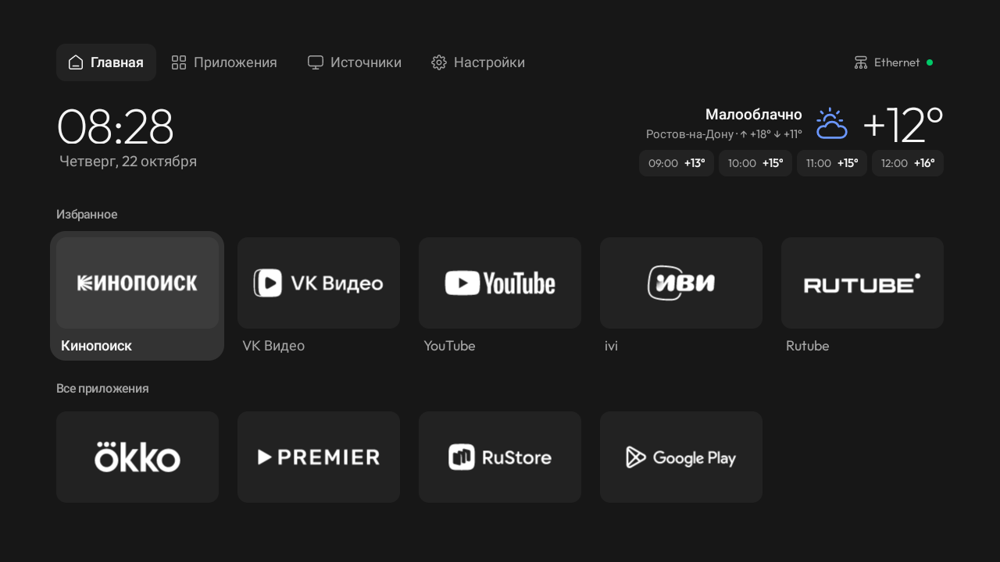
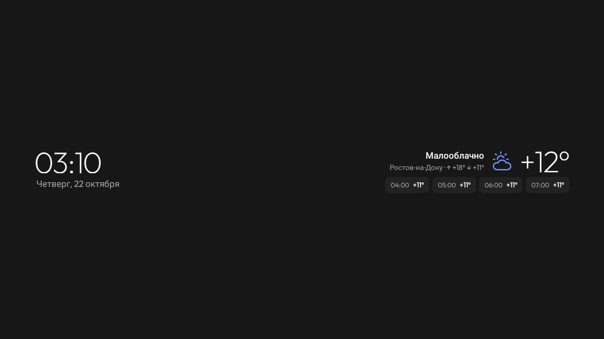
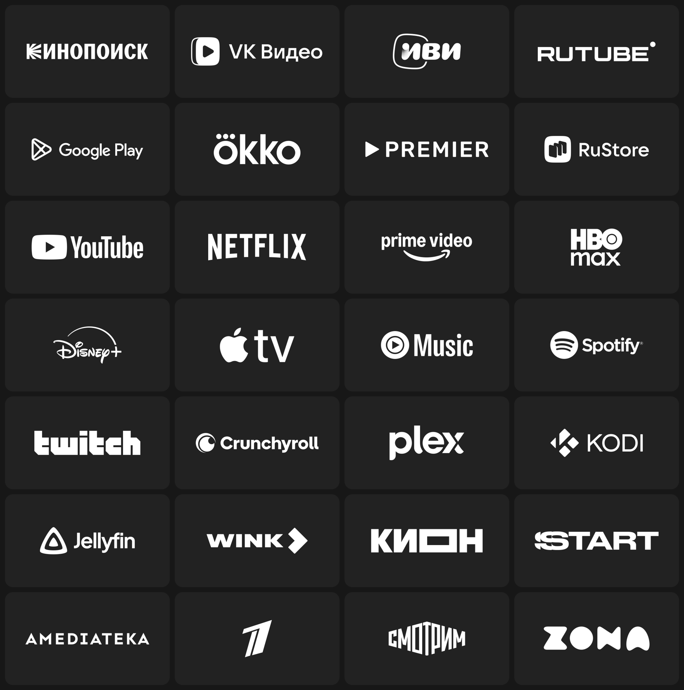

# stillOS

[English](README.md) · **Русский**

Спокойный главный экран для Android TV. Никаких кричащих баннеров и лент рекомендаций: ваши приложения на тихих
плитках с белыми логотипами, время, погода — и всё. stillOS — переделанный лаунчер из
[cleanyourtv](https://github.com/Gathin23/cleanyourtv), сделанный для телевизора Xiaomi, у которого стандартный
главный экран ставил рекламу и рекомендации впереди приложений.



<sub>Снимок с телевизора Xiaomi MiTV-MOSR1.</sub>

## Что изменено

- **Одинаковые плитки с белыми логотипами.** Вместо цветных баннеров у каждого приложения одинаковая тёмная плитка
  с белым логотипом сервиса. В наборе 28 сервисов: Кинопоиск, VK Видео, ivi, Okko, Rutube, Premier, Wink, КИОН,
  START, Амедиатека, Первый канал, Смотрим, Zona, YouTube, Netflix, Disney+, Spotify и другие. У остальных
  приложений на плитке название.
- **Простая шапка.** Главная, Приложения, Источники и Настройки с иконками [Untitled UI](https://www.untitledui.com/free-icons).
  «Источники» открывают небольшое меню: HDMI, AV и телеканалы.
- **Погода.** Сейчас, максимум и минимум за день и ближайшие четыре часа, дождливые часы подсвечены. Нажмите OK на
  погоде, чтобы выбрать город из списка или найти любой.
- **Сеть одним взглядом.** Значок Wi‑Fi или Ethernet, название сети и точка: зелёная, когда интернет есть, жёлтая,
  когда сеть без интернета, красная без сети.
- **Заставка в том же стиле.** Часы, дата и погода в одну строку. Раз в минуту строка незаметно сдвигается на
  несколько пикселей, чтобы ничего не выгорало.
- **Спокойная анимация.** Между плитками мягко переезжает одна подложка фокуса, ничего не прыгает и не увеличивается.
- **Избранное меняется с пульта.** Зажмите OK на «Настройках» и выберите «Изменить избранное».
- **Кнопки пульта.** На пульте MiTV кнопка Netflix открывает VK Видео, а ▦ — все приложения. Назначения меняются в
  `launcher/app/src/main/res/values/config.xml` (`app_keys`).



<sub>Заставка на телевизоре.</sub>



## На чём проверено

Xiaomi MiTV-MOSR1 (Android TV 11, 1280×720, 1 ГБ). Лаунчер должен работать и на других телевизорах с Android TV 8
и новее, где работает лаунчер cleanyourtv, но проверен только этот. Список отключаемых приложений для него лежит в
[`examples/xiaomi-mitv-mosr1`](examples/xiaomi-mitv-mosr1/debloat.txt).

## Установка

Нужен компьютер в той же сети, что и телевизор, JDK 17 и Android SDK (платформа 34).

1. На телевизоре включите режим разработчика (Настройки → Настройки устройства → Об устройстве → семь раз нажмите
   OK на «Сборке»), затем включите отладку по USB. Запишите IP-адрес телевизора.
2. Склонируйте этот репозиторий.
3. По желанию отключите ненужные предустановленные приложения. Они отключаются, а не удаляются, и возвращаются
   одной командой.

   ```bash
   TV_HOST=192.168.1.50 tools/disable.sh examples/xiaomi-mitv-mosr1/debloat.txt
   ```

4. Соберите лаунчер и сделайте его главным экраном:

   ```bash
   TV_HOST=192.168.1.50 HOME_KEY_SERVICE=1 launcher/build-and-install.sh
   ```

5. Разрешите отладку на телевизоре и нажмите на пульте «Домой».

Вернуть стандартный лаунчер:
`TV_HOST=192.168.1.50 tools/restore.sh examples/xiaomi-mitv-mosr1/debloat.txt com.google.android.tvlauncher`
(последний аргумент — стандартный лаунчер вашего телевизора). Подробности, другие модели и установка через
ИИ-агента по [`PROMPT.md`](PROMPT.md) — в [`CLEANYOURTV.md`](CLEANYOURTV.md) (на английском).

## Сеть

Лаунчер обращается к двум сервисам, и только ради погоды:

- [MET Norway](https://api.met.no/) (прогноз yr.no): один небольшой запрос раз в 30 минут, пока открыта главная
  или заставка, с координатами выбранного города.
- [OpenStreetMap Nominatim](https://nominatim.openstreetmap.org/): только когда вы ищете город, с тем, что вы ввели.

Оба бесплатные, без ключей; в запросах указано название проекта. Больше ничего с телевизора не уходит: ни
аккаунтов, ни аналитики.

## Логотипы и благодарности

Логотипы сервисов — товарные знаки их владельцев и используются только для подписи их же приложений на плитках.
Ни одна компания проект не одобряла; если вы правообладатель и хотите убрать логотип, откройте issue. Источник
каждого логотипа указан в [`design/brand/NOTICE.md`](design/brand/NOTICE.md).

- Лаунчер и инструменты: [cleanyourtv](https://github.com/Gathin23/cleanyourtv), Gathin и участники, MIT.
- Иконки: бесплатный набор [Untitled UI](https://www.untitledui.com/free-icons).
- Шрифт: [Outfit](https://fonts.google.com/specimen/Outfit), SIL Open Font License.
- Погода: [MET Norway](https://api.met.no/), CC BY 4.0. Поиск мест: © участники OpenStreetMap, ODbL.

Код под лицензией MIT, как и у исходного проекта: см. [`LICENSE`](LICENSE).
